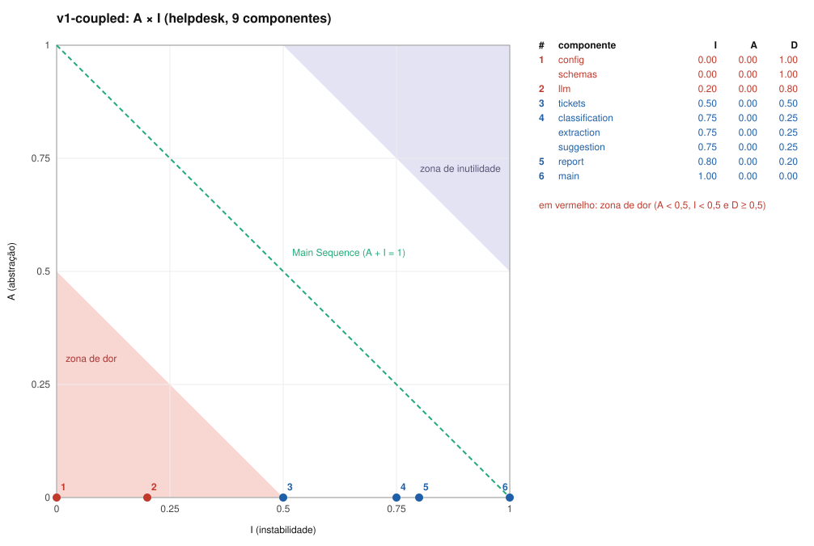

# Helpdesk com IA: da integração frágil à arquitetura resiliente

> Fork de [devfullcycle/desafio-arquitetura-era-ia-1](https://github.com/devfullcycle/desafio-arquitetura-era-ia-1). O enunciado original está em [docs/enunciado.md](docs/enunciado.md).

## Visão geral

_A preencher ao final (requisitos 4 a 7)._

## Diagnóstico da v1

Os trechos de `app/` citados nesta seção são os da tag `v1-coupled` (`git show v1-coupled:app/helpdesk/llm.py`). Depois da refatoração, `llm.py` e `config.py` deixaram de existir.

Ambiente: `cp .env.example .env && docker compose up -d --build --wait`, tudo medido pela borda (`localhost:8000`) e conferido em `GET localhost:8090/admin/calls`. Horários em UTC (o formato de `ts` no `/admin/calls`). Horários, IDs de container e custos são os desta execução e mudam a cada vez que o roteiro roda; o que precisa se repetir são os padrões: o `504` em 30 s, o número de tentativas por requisição, as chamadas que continuam depois do `504` e o container recriado. A Dor 1 e o bloco `openai` da Dor 3 rodaram ao mesmo tempo, cada um num provider, e por isso os horários se sobrepõem; o `/admin/calls` separa as chamadas por `provider` e `task`. As demais medições rodaram depois, uma de cada vez. Ticket de referência:

```sh
T='{"ticket_id": "TK-00042", "text": "Meu pedido #481516 não chegou e já passou do prazo, urgente"}'
```

Linha de base com o provider em modo normal:

| Feature | Rota | Status | Tempo total (borda) | `/admin/calls` |
|---|---|---|---|---|
| F1 | `POST /tickets/classification` | 200 | 1,13 s | 1 chamada `openai/gpt-fake-large`, `classify`, 1.076 ms |
| F4 | `POST /tickets/extraction` | 200 | 1,09 s | 1 chamada `openai/gpt-fake-large`, `extract`, 1.076 ms |
| F2 | `POST /tickets/reply-suggestion` | 200 | 15,99 s (primeiro byte também em 15,99 s) | 1 chamada `anthropic/claude-fake-large`, `suggest`, `stream: false`, 606 tokens de saída, 15.952 ms |
| F3 (1 dia) | `POST /reports/topics` `2026-08-01..2026-08-01` | 200 | 9,87 s | 1 chamada `topics`, 137 tickets = 6.132 tokens de entrada, 9.804 ms |

Padrões dos SDKs dentro do container `app` (`openai 3.19.0`, `anthropic 1.8.0`), lidos com `docker compose exec app python -c "..."`: `timeout=Timeout(connect=5.0, read=600, write=600, pool=600)` e `max_retries=2` nos dois, ou seja, até **3 tentativas de até 600 s cada**. A borda (`edge/nginx.conf:21`, `proxy_read_timeout 30s`) desiste em 30 s.

### Dor 1: o relatório do mês nunca chega (e continua custando)

```sh
curl -s -w "\n" -X POST localhost:8090/admin/reset
curl -s -w "status=%{http_code} total=%{time_total}s\n" -X POST localhost:8000/reports/topics \
  -H "Content-Type: application/json" -d '{"start":"2026-08-01","end":"2026-08-31"}'
# depois, a cada 30 s:
curl -s "localhost:8090/admin/calls?last=5000"
```

Observado:

- A borda responde `504 Gateway Time-out` em **30,02 s** (pedido às 22:23:59, 504 às 22:24:29).
- `/admin/calls` mostra **34 chamadas** `anthropic/claude-fake-large`, `task: topics`, `stream: false`, todas `200`, uma depois da outra (~9,7 s cada), da 22:24:00 até a última às 22:29:23 (terminada às 22:29:32): **~5,5 min** para o relatório inteiro.
- **Só as 3 primeiras chamadas começaram antes do 504.** A 4ª começou às 22:24:30.065, praticamente no instante em que a borda desistiu: o horário do pedido tem resolução de segundo, então não dá para dizer de que lado do 504 ela fica. As 30 seguintes começaram com certeza depois. O `/admin/calls` registra tokens, não dinheiro; o custo abaixo aplica aos tokens registrados o preço do `claude-fake-large` na tabela de Modelos de `provider-fake/README.md` (US$ 3,00 por 1M de entrada e US$ 15,00 por 1M de saída):

  | Chamadas `topics` | Tokens de entrada | Tokens de saída | Custo |
  |---|---|---|---|
  | Todas (34) | 222.114 | 12.162 | 222.114 × 3,00/1M + 12.162 × 15,00/1M = **US$ 0,85** |
  | Da 4ª em diante (31) | 202.139 | 11.079 | 202.139 × 3,00/1M + 11.079 × 15,00/1M = **US$ 0,77 (91%)** |
  | Da 5ª em diante (30, com certeza depois do `504`) | 195.483 | 10.742 | 195.483 × 3,00/1M + 10.742 × 15,00/1M = **US$ 0,75 (88%)** |

  Entre 88% e 91% do custo foram gastos num relatório que nunca é entregue. Cada nova tentativa do painel repete a conta inteira.

Causa:

- `app/helpdesk/main.py:30-31`: rota síncrona; o resultado só é enviado quando o relatório inteiro termina.
- `app/helpdesk/report.py:15-18`: 5.000 tickets em lotes de 150 (`config.py:18`), ou seja, 34 chamadas `topics` em série, cada uma com ~9,7 s (`claude-fake-large`, ~6.500 tokens de entrada em média). São ~5,5 min sem enviar nenhum byte, contra os 30 s da borda.
- Desistir não é cancelar: a rota é `def` (roda no threadpool do Starlette) e nada observa a desconexão do cliente. Depois do `504`, o laço de `report.py:15` segue chamando o provider até o fim, e alguém paga esses tokens por uma resposta que ninguém vai receber.

### Dor 2: o atendente olha uma tela parada esperando a sugestão

```sh
curl -sN -o /dev/null -w "status=%{http_code} ttfb=%{time_starttransfer}s total=%{time_total}s\n" \
  -X POST localhost:8000/tickets/reply-suggestion -H "Content-Type: application/json" -d "$T"

# o mesmo com o modelo lento
curl -s -w "\n" -X POST localhost:8090/admin/failures -H "Content-Type: application/json" \
  -d '{"provider": "anthropic", "model": "claude-fake-large", "mode": "slow"}'
curl -sN -o /dev/null -w "status=%{http_code} ttfb=%{time_starttransfer}s total=%{time_total}s\n" \
  -X POST localhost:8000/tickets/reply-suggestion -H "Content-Type: application/json" -d "$T"
curl -s "localhost:8090/admin/calls?last=1"   # repetir até duration_ms aparecer
curl -s -w "\n" -X POST localhost:8090/admin/reset
```

Observado:

- Modo normal: `status=200 ttfb=15.99s total=15.99s`. O primeiro byte chega junto com o último: durante 16 s o atendente não vê nada. Em `/admin/calls`, a chamada `suggest` tem `stream: false`, 606 tokens de saída em 15.952 ms (800 ms até o primeiro token + 606 / 40 tokens/s).
- `claude-fake-large` em `slow`: `status=504 ttfb=30.02s total=30.02s`. A borda desiste sem ter recebido nenhum byte. A chamada `suggest` começou às 22:48:16 e só terminou no provider 159.501 ms depois, com `200` e os mesmos 606 tokens de saída: um texto gerado e pago **2 min 9 s depois** de o atendente ter recebido o erro.

Causa:

- `app/helpdesk/llm.py:21-25`: `messages.create` sem `stream=True`; o SDK só devolve quando a geração inteira termina.
- `app/helpdesk/suggestion.py:6-7` e `app/helpdesk/main.py:20-21`: a rota devolve um JSON único com o texto completo. O modelo já gera em ~0,8 s o primeiro trecho, mas a arquitetura o retém por mais 15 s. Com um provider mais lento, essa retenção passa dos 30 s da borda.

### Dor 3: com um provider fora do ar ou travado, parte do helpdesk para

```sh
curl -s -w "\n" -X POST localhost:8090/admin/reset
curl -s -w "\n" -X POST localhost:8090/admin/failures -H "Content-Type: application/json" \
  -d '{"provider": "openai", "mode": "error_500"}'
curl -s -w " status=%{http_code} total=%{time_total}s\n" -X POST localhost:8000/tickets/classification -H "Content-Type: application/json" -d "$T"
curl -s -w " status=%{http_code} total=%{time_total}s\n" -X POST localhost:8000/tickets/extraction -H "Content-Type: application/json" -d "$T"
curl -s -o /dev/null -w "status=%{http_code} total=%{time_total}s\n" -X POST localhost:8000/tickets/reply-suggestion -H "Content-Type: application/json" -d "$T"
curl -s -o /dev/null -w "status=%{http_code} total=%{time_total}s\n" -X POST localhost:8000/reports/topics -H "Content-Type: application/json" -d '{"start":"2026-08-01","end":"2026-08-01"}'
curl -s "localhost:8090/admin/calls?last=10"

curl -s -w "\n" -X POST localhost:8090/admin/failures -H "Content-Type: application/json" \
  -d '{"provider": "openai", "mode": "timeout"}'
curl -s -w " status=%{http_code} total=%{time_total}s\n" -X POST localhost:8000/tickets/classification -H "Content-Type: application/json" -d "$T"
curl -s "localhost:8090/admin/calls?last=10"   # repetir: a 2ª tentativa aparece ~300 s depois da 1ª
# depois que a 2ª tentativa aparecer, voltar o openai ao normal para ver a 3ª concluir sem ninguém esperando
curl -s -w "\n" -X POST localhost:8090/admin/failures -H "Content-Type: application/json" \
  -d '{"provider": "openai", "mode": "normal"}'
curl -s "localhost:8090/admin/calls?last=10"   # ~300 s depois: 3ª tentativa com status 200

curl -s -w "\n" -X POST localhost:8090/admin/reset
curl -s -w "\n" -X POST localhost:8090/admin/failures -H "Content-Type: application/json" \
  -d '{"provider": "anthropic", "mode": "error_500"}'
curl -s -w " status=%{http_code} total=%{time_total}s\n" -X POST localhost:8000/tickets/reply-suggestion -H "Content-Type: application/json" -d "$T"
curl -s -w " status=%{http_code} total=%{time_total}s\n" -X POST localhost:8000/reports/topics -H "Content-Type: application/json" -d '{"start":"2026-08-01","end":"2026-08-01"}'
curl -s -w " status=%{http_code} total=%{time_total}s\n" -X POST localhost:8000/tickets/classification -H "Content-Type: application/json" -d "$T"
curl -s -w "\n" -X POST localhost:8090/admin/reset
```

Observado:

- `openai` em `error_500`: F1 e F4 respondem `500 Internal Server Error` (texto puro, sem corpo JSON) em ~1,4 s. `/admin/calls` mostra **3 chamadas** `gpt-fake-large` com status `500` para cada requisição (1 + 2 retries do SDK), todas no mesmo provider. Nenhuma tentativa no `anthropic`, onde o modelo equivalente estava saudável. No log do `app`, `openai.InternalServerError` sem tratamento (traceback do ASGI). No mesmo cenário, F2 responde `200` em 15,97 s e F3 (1 dia) `200` em 9,90 s, ambas pelo `anthropic`.
- `openai` em `timeout`: F1 recebe `504 Gateway Time-out` da borda em **30,01 s** (22:24:43). A aplicação não desiste. `/admin/calls` mostra:

  | Tentativa | Início | Status no provider | `duration_ms` |
  |---|---|---|---|
  | 1ª | 22:24:13 | `504` (modo `timeout`) | 300.000 |
  | 2ª | 22:29:13 | `504` (modo `timeout`) | 300.001 |
  | 3ª | 22:34:14 | `200` (o `openai` voltou a `normal` às 22:29:29, como no roteiro) | 1.076 |

  A aplicação concluiu e pagou a classificação **10 minutos depois** de o cliente ter recebido o 504. Entre uma tentativa e outra, o SDK esperou de 0,5 a 0,8 s de backoff.

  Estimativa, não medida: sem a volta ao `normal`, a 3ª tentativa também esperaria 300 s e terminaria em `504`. Pelo `max_retries=2` do SDK e os 300 s medidos por tentativa, seriam **~15 min** até o SDK desistir e o app responder `500`. Durante todo esse tempo, a requisição ocupa uma das 40 threads do threadpool padrão (anyio), onde o Starlette roda as rotas `def`.
- `anthropic` em `error_500`: F2 (`/tickets/reply-suggestion`) e F3 (`/reports/topics`) respondem `500` em ~1,4 s, cada uma com 3 chamadas `claude-fake-large` com status `500` em `/admin/calls`; no mesmo instante a F1 responde `200` pelo `openai`. Em qualquer dos dois casos, **metade do helpdesk para junto com um provider**, embora o modelo equivalente do outro provider esteja saudável.

Causa:

- `app/helpdesk/config.py:10-13`: cada feature está presa a um único modelo físico de um único provider; não existe destino alternativo.
- `app/helpdesk/llm.py:8-9`: clientes criados sem `timeout` nem `max_retries`, valendo os padrões (600 s de leitura, 2 retries). Uma chamada travada segura a requisição por até 3 × 300 s no modo `timeout`, muito além dos 30 s da borda; um `500` vira 3 chamadas ao mesmo provider caído (cada uma registrada em `/admin/calls` com `input_tokens: 19` e `output_tokens: null`).
- `app/helpdesk/classification.py:11` e `extraction.py:12`: a exceção do SDK não é tratada; o cliente recebe `500` genérico, sem dizer o que aconteceu.

### Dor 4: trocar o modelo de uma feature exige mudar código e reconstruir

Alteração temporária em `app/` só para a demonstração, desfeita em seguida (`git checkout -- app/helpdesk/config.py`, `git status` limpo em `app/`), antes da tag `v1-coupled`:

```sh
# 1. a única forma de trocar o modelo da F1 é editar o código
sed -i 's/^CLASSIFICATION_MODEL = "gpt-fake-large"/CLASSIFICATION_MODEL = "gpt-fake-mini"/' app/helpdesk/config.py
# 2. reiniciar não basta
docker compose restart app
curl -s -X POST localhost:8000/tickets/classification -H "Content-Type: application/json" -d "$T"
curl -s "localhost:8090/admin/calls?last=1"
# 3. é preciso reconstruir a imagem
docker compose up -d --build --wait app
curl -s -X POST localhost:8000/tickets/classification -H "Content-Type: application/json" -d "$T"
curl -s "localhost:8090/admin/calls?last=1"
# 4. desfazer
git checkout -- app/helpdesk/config.py && docker compose up -d --build --wait app
```

Observado:

| Passo | Container `app` | `/admin/calls` da F1 |
|---|---|---|
| Inicial | `76164335e7cc` | `openai/gpt-fake-large` |
| `config.py` editado + `docker compose restart app` | `76164335e7cc` (o mesmo) | `openai/gpt-fake-large`: **a troca não aconteceu** |
| `docker compose up -d --build app` | `a0f3fdcccd35` (novo) | `openai/gpt-fake-mini`, F1 em 0,43 s |
| Alteração desfeita + rebuild | `cdc5098c2271` (novo) | `openai/gpt-fake-large` |

O passo 3 (`docker compose up -d --build --wait app` com o `config.py` alterado) levou **111 s** do comando até o container novo ficar saudável. Trocar um modelo virou um deploy da aplicação, com mudança de código, imagem nova e container recriado.

Causa:

- `app/helpdesk/config.py:10-13`: o nome do modelo físico é uma constante no código-fonte, não uma configuração. E não só o nome: `config.py:3-7` também fixa as chaves e as base URLs de cada provider, e `llm.py:13-26` fixa o formato de API de cada um. Trocar para um modelo de outro provider exige ainda mudar a função chamada em cada feature (`classification.py:11`, `extraction.py:12`, `suggestion.py:6`, `report.py:18`).
- `app/Dockerfile:6`: `COPY helpdesk ./helpdesk` congela o código na imagem. As chaves já chegam pelo ambiente (`env_file: .env` no `compose.yaml`, lidas em `config.py:3-4`), mas o nome do modelo não: não há volume nem variável de ambiente que permita trocá-lo sem reconstruir.

A quarta fricção proposital, "o modelo barato não é tão bom", foi verificada no reconhecimento. A evidência está em "Tabela de fallback", na subseção "Evidência: modelos `large` × `mini`", onde vai sustentar a política de fallback.

## Como rodar

```sh
cp .env.example .env
docker compose up -d --build --wait
curl -s localhost:8000/health
```

### Testes de caracterização

A suíte em `tests/characterization/` roda do host contra o compose no ar, sempre pela borda (`localhost:8000`). Ela começa com `POST localhost:8090/admin/reset` para garantir o provider em modo normal, o que também limpa o registro do `/admin/calls`. Pré-requisito: Python 3.12, de preferência num venv.

```sh
python -m pip install -r tests/characterization/requirements.txt   # uma vez
python -m pytest tests/characterization
```

As URLs podem ser trocadas pelas variáveis `HELPDESK_URL` e `PROVIDER_URL`. A suíte leva ~1,5 min, porque F2 e F3 levam de 10 a 20 s por chamada na v1.

Para cada caso, a suíte fixa o status, o `Content-Type` e o corpo inteiro da resposta (campos e valores), conforme o comportamento da `v1-coupled`:

| Feature | Casos de sucesso | Erros de entrada (`422`) |
|---|---|---|
| F1 | 8 tickets, cobrindo as 5 categorias e as 3 prioridades | `text` vazio, sem `ticket_id`, JSON malformado |
| F2 | 2 sugestões completas, gravadas em `golden/` | sem `text`, `text` numérico |
| F3 | 1 dia (1 lote), 2 dias (274 tickets em 2 lotes, o que fixa a soma dos lotes) e um período sem tickets, todos gravados em `golden/` exceto o vazio | `start` depois de `end`, data inexistente, sem `end` |
| F4 | 8 tickets: nota fiscal antes do pedido, pedido sem `#`, com e sem produto | `ticket_id` vazio |

Nos casos de erro e no período sem tickets, a suíte também confere em `/admin/calls` que nenhuma chamada chegou ao provider.

A suíte detecta a troca de um `large` por um `mini` em F2 e F4. Com o `mini`, a sugestão da F2 muda, e 5 dos 7 tickets do dataset da F4 dão outro resultado: por exemplo, o `TK-00002` devolve a nota fiscal `#530720` no lugar do pedido. Em F1 e F3, o `mini` dá a mesma saída (ver "Evidência: modelos `large` × `mini`").

### Métrica de acoplamento

O script `metrics/coupling.py` usa só a biblioteca padrão (Python 3.12). Ele recebe a pasta do pacote a medir e um nome, e grava `metrics/results/<nome>.csv` e `metrics/results/<nome>.svg`:

```sh
# o código do checkout atual
python metrics/coupling.py app/helpdesk main

# uma tag: o script da branch atual sobre um checkout dela
git worktree add ../v1 v1-coupled
python metrics/coupling.py ../v1/app/helpdesk v1-coupled
git worktree remove ../v1
```

## Métrica

A régua é a do requisito 3: componente é cada módulo `.py` de `app/helpdesk/` (inclusive em subpastas, exceto `__init__.py`), dependência é um import que resolve para outro componente, e I, A e D seguem as fórmulas do enunciado. Onde o enunciado deixa espaço, o script decide assim (está no docstring de `metrics/coupling.py`):

- conta qualquer import do módulo, inclusive dentro de funções;
- um import que resolve para um pacote (o `__init__.py`) não conta, porque o pacote não é componente;
- uma classe é abstrata quando `typing.Protocol` ou `abc.ABC` está entre as suas bases diretas;
- os valores são calculados com frações exatas e arredondados para 2 casas, com meio para cima.

O script foi conferido contra um pacote sintético com subpastas, imports relativos de 1 e 2 níveis, import absoluto, import dentro de função e as variações de `Protocol` e `ABC`. Rodar duas vezes sobre o mesmo checkout gera CSV e SVG idênticos byte a byte.

### v1-coupled



Resultado em [metrics/results/v1-coupled.csv](metrics/results/v1-coupled.csv). Conferência à mão de três módulos, como o enunciado sugere:

| Componente | Quem importa (Ca) | O que importa (Ce) | I | A | D |
|---|---|---|---|---|---|
| `config` | `classification`, `extraction`, `llm`, `report`, `suggestion`, `tickets` (6) | nada além de `os` (0) | 0 / (0 + 6) = 0,00 | sem classes: 0,00 | \|0 + 0 − 1\| = 1,00 |
| `llm` | `classification`, `extraction`, `report`, `suggestion` (4) | `config` (1); `openai`, `anthropic` e `json` são externos | 1 / (1 + 4) = 0,20 | sem classes: 0,00 | \|0 + 0,2 − 1\| = 0,80 |
| `report` | `main` (1) | `config`, `llm`, `tickets`, `schemas` (4) | 4 / (4 + 1) = 0,80 | sem classes: 0,00 | \|0 + 0,8 − 1\| = 0,20 |

Leitura:

- **Nenhum componente tem abstração.** A = 0 em todos; as 7 classes de `schemas` são modelos pydantic concretos. Todos os pontos ficam no eixo horizontal, e a distância da Main Sequence é só 1 − I.
- **Três componentes na zona de dor:** `config` (D 1,00), `schemas` (D 1,00) e `llm` (D 0,80). São os mais importados (Ca 6, 5 e 4) e totalmente concretos, então qualquer mudança neles se propaga para as features.
  - `llm` é onde mora o acoplamento com os providers: dois SDKs, dois formatos de API, clientes sem timeout (Dores 2 e 3). É concreto, muito dependido e volátil de verdade. Pela régua, o componente que chama o modelo não pode ser exceção.
  - `config` junta chaves, base URLs e nomes de modelos físicos, os detalhes mais voláteis do sistema (Dor 4), e é o componente mais importado. Também é dor real.
  - `schemas` são os tipos de valor do contrato HTTP das 4 features, que só mudam quando o contrato muda. É candidato a "estável por natureza" no ADR da métrica.
- **As features** (`classification`, `extraction`, `suggestion` e `report`) têm I de 0,75 a 0,80 e D de 0,20 a 0,25. Ficam perto da Main Sequence, mas o problema delas aparece do outro lado da dependência: todas importam diretamente o `llm` e o `config` concretos.
- **`main`** (I 1,00, D 0,00) é o ponto de composição. **`tickets`** (I 0,50, D 0,50) fica na fronteira da zona de dor, sem entrar nela.

### v2-decoupled


Resultado em [metrics/results/v2-decoupled.csv](metrics/results/v2-decoupled.csv). O caminho até aqui (plano, piloto medido antes e depois, revisões e handoff para o agente) está em [docs/refactoring-plan.md](docs/refactoring-plan.md).

Leitura, comparando com a v1:

- **`llm` e `config` saíram do gráfico.** Os dois estavam na zona de dor (D 0,80 e 1,00) e concentravam SDK, credencial e nome de modelo. O nome do modelo e as chaves foram para o gateway. O que sobrou de configuração (URL e chave do gateway, caminho dos tickets) é lido em `main`, o ponto de composição.
- **`ports` é o novo centro.** É o componente mais dependido (Ca 6: as 4 features e os 2 adaptadores) e é totalmente abstrato (2 `Protocol`s). Fica no canto estável-abstrato, sobre a Main Sequence (D 0,00): o que muitos usam é justamente o que não tem implementação para mudar.
- **As features dependem só da porta e do contrato.** `classification`, `extraction`, `suggestion` e `report` têm Ce {`ports`, `schemas`}, I 0,67 e D 0,33. Na v1 tinham I de 0,75 a 0,80, mas dependiam de `llm` e `config` concretos.
- **Os adaptadores são detalhes que dependem da abstração.** `gateway` (o único com SDK) e `tickets` declaram a porta que implementam e só `main` os importa: I 0,50, D 0,50, fora da zona de dor. Isso não estava no plano original: o piloto mostrou o adaptador na zona de dor quando ele implementava a porta só estruturalmente (Revisão 1 do plano).
- **`schemas` continua na zona de dor** (D 1,00). São os tipos de valor do contrato HTTP, que só mudam quando o contrato muda. Vai ser declarado "estável por natureza" no ADR da métrica.

_main: a preencher (requisito 6)._

## Tabela de capacidades

_A preencher (requisito 5)._

## Tabela de fallback

_Tabela a preencher (requisito 5). A evidência abaixo, colhida no reconhecimento, vai sustentar a decisão sobre o modelo fraco no ADR de fallback._

### Evidência: modelos `large` × `mini`

Chamadas diretas ao provider (`localhost:8090`), mesma entrada nos dois tamanhos: os primeiros 60 tickets de `data/tickets.jsonl` em `classify`/`extract` (`gpt-fake-large` × `gpt-fake-mini`), um lote de 150 em `topics` e um ticket em `suggest` (`claude-fake-large` × `claude-fake-mini`):

| Tarefa | `large` × `mini` | Tempo `large` → `mini` |
|---|---|---|
| `classify` | 0/60 saídas diferentes | ~1,1 s → ~0,4 s |
| `extract` | **15/60 saídas diferentes (25%)**. Ex.: `TK-00002` "nota fiscal 530720 ... pedido #605065": `large` → `#605065`, `mini` → `#530720` (a nota fiscal). `TK-00007` "notebook 14 polegadas": `large` identifica o produto, `mini` devolve `product: null` | ~1,1 s → ~0,4 s |
| `topics` | saída idêntica (lote de 150 tickets) | 9,8 s → 2,7 s |
| `suggest` | texto mais curto e menos completo: 2.402 → 1.066 caracteres | 15,8 s → 2,1 s |

Os dois `large` (`gpt-fake-large` e `claude-fake-large`) deram saídas idênticas em `extract` nos 10 primeiros tickets de `data/tickets.jsonl`, como o README do provider afirma.

Para reproduzir o caso mais grave (`extract` no `TK-00002`), troque só o `model`:

```sh
for m in gpt-fake-large gpt-fake-mini; do
  curl -s localhost:8090/openai/v1/chat/completions \
    -H "Authorization: Bearer sk-fake-openai-0001" -H "Content-Type: application/json" \
    -d "{\"model\": \"$m\", \"messages\": [{\"role\": \"user\", \"content\": \"TASK: extract\nTenho aqui a nota fiscal 530720. O produto veio quebrado na caixa, pedido #605065.\"}]}" \
    | python -c "import json,sys; print('$m', json.load(sys.stdin)['choices'][0]['message']['content'])"
done
```

## Fluxos

_A preencher (requisito 6)._

## Troca de modelo

_A preencher (requisito 5)._

## Roteiro de governança

_A preencher (requisito 5)._

## Mapa de decisões

_A preencher (requisito 7)._
